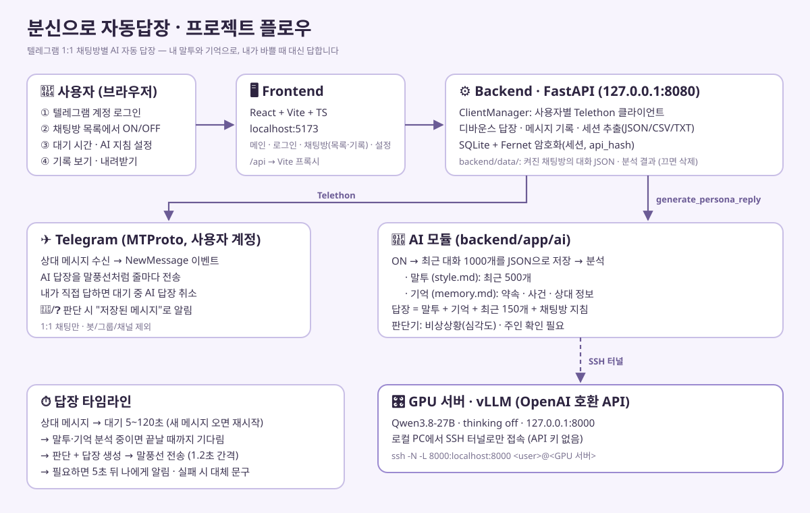

# 분신으로 자동답장

<p align="center"></p>

## 🎬 시연 데모 영상

[▶ 시연 데모 영상 보기 (Google Drive)](https://drive.google.com/drive/folders/1yrVlYxeC0Z5kaF5rC6n2qMtNP1pwF_hc?hl=ko)

## 📌 프로젝트 개요

> **데이트 준비 중에 여자친구 연락을 놓쳐서 서운하게 한 적, 바쁜 날 친구 메시지에 하루 늦게 답한 적, 운전 중이라 답장을 못 해서 "왜 읽고 답이 없어?"라는 말을 들어 본 적 있으신가요?**
>
> 이제 나 대신 **내 말투로**, **우리가 나눈 대화를 기억하며** 답해 주는 분신을 켜 두세요.

내가 바쁠 때 내 말투와 기억으로 대신 답하는 텔레그램 AI 분신입니다 (Kirothon 해커톤).

관리자 페이지에서 내 텔레그램 계정으로 로그인하고, 1:1 채팅방마다 자동 답장을 켜고 끕니다. 켜진 채팅방에 상대가 메시지를 보내면, AI가 지금까지의 대화에서 익힌 **내 말투**와 **우리가 나눈 기억**으로 답장합니다. 상대가 아프다거나 내가 직접 정해야 하는 질문이 오면 나에게 따로 알려 줍니다.

### 왜 카카오톡이 아니라 텔레그램인가요?

우리가 일상에서 가장 많이 쓰는 메신저는 카카오톡이지만, 카카오톡은 **내 계정으로 개인 대화를 읽고 나 대신 메시지를 보내는 API를 제공하지 않습니다.** 공개된 API는 채널·비즈니스 메시지나 "나에게 보내기" 정도라서, 친구와의 1:1 대화에 자동으로 답할 방법이 없습니다.

텔레그램은 사용자 계정으로 로그인하는 공식 클라이언트 API(MTProto)를 공개하고 있어서, 내 계정으로 1:1 대화를 받고 내 이름으로 답장할 수 있습니다. 그래서 이 프로젝트는 텔레그램을 채택했습니다. 봇 계정(Bot API)은 내 개인 대화를 읽거나 내 이름으로 보낼 수 없어서, Telethon으로 **사용자 계정 자체에 로그인**하는 방식을 씁니다.

## 프로젝트 플로우



## 주요 기능

> **🧠 모든 분석과 답장은 Qwen3.8-27B가 직접 만듭니다.**
> 외부 상용 AI API(ChatGPT, Claude 등)를 쓰지 않고, 우리가 직접 운영하는 GPU 서버의 vLLM 위에서 돌아가는 오픈 모델 하나로 말투 분석, 기억 추출, 상황 판단, 답장 생성을 모두 처리합니다. 대화 내용은 외부 AI 회사로 나가지 않고, SSH 터널을 통해 우리 서버로만 전달됩니다.

| Qwen3.8이 하는 일 | 내용 |
|---|---|
| 🗣 말투 분석 | 최근 대화 500개에서 내 호칭, 어미, 웃음(ㅋㅋ/ㅎㅎ), 줄임말, 자주 쓰는 표현을 뽑아 `style.md`로 정리 |
| 📒 기억 추출 | 대화 1000개를 250개씩 나눠 병렬로 약속·있었던 일·상대 정보를 뽑고, 하나로 합쳐 `memory.md`로 정리 |
| 🚦 상황 판단 | 새 메시지마다 비상상황(심각도)인지, 내가 직접 정해야 하는 질문인지 JSON으로 판단 |
| 💬 답장 생성 | 말투 + 기억 + 최근 대화 150개 + 채팅방 지침으로 내 말투의 짧은 답장 생성 (thinking 모드 끔, 1~5초) |

| 기능 | 설명 |
|---|---|
| 내 계정으로 로그인 | 각자 자기 텔레그램 `api_id`/`api_hash`와 전화번호, 인증 코드(2단계 인증 포함)로 로그인. 세션은 암호화해 저장 |
| 채팅방별 ON/OFF | 1:1 채팅방 목록에서 토글. 대기 시간(5~120초), AI 지침, 실패 시 대체 문구를 채팅방마다 설정 |
| 말투·기억 분석 | 켜는 순간 최근 대화 최대 1000개를 **Qwen3.8**이 분석해 말투와 기억을 추출. 진행 상태를 화면에 표시 |
| 자연스러운 답장 | 상대가 연달아 보내면 마지막 메시지 기준으로 한 번만 답장. 답장은 말풍선처럼 줄마다 나눠 전송. 기다리는 동안 내가 직접 답하면 AI는 양보 |
| 주인 알림 | 비상상황(심각도 낮음/중간/높음)이나 기억에 없는 약속·결정 질문이면 "확인해보고 알려줄게"로 보류하고, 내 "저장된 메시지"로 알림 |
| 기록 내려받기 | ON~OFF 구간을 세션으로 기록. 대화 미리 보기, JSON/CSV/TXT 다운로드. AI 답장은 구분 표시 |

## 예시

상대가 메시지를 보내면 AI가 먼저 상황을 판단하고, 상황에 맞게 답합니다. (아래는 테스트 대화 예시입니다.)

### 💬 일반 상황

기억(`memory.md`)과 말투(`style.md`)로 바로 답합니다.

```
여자친구: 근데 우리 토요일에 어디서 보기로 했지?
분신(AI): 강남역 순대국밥집 3시 ㄱ                      ← 지난 대화에서 찾은 약속을 내 말투로
```

### 🚨 비상 상황 (Emergency)

상대가 아프거나 다쳤거나 위험한 상황이면 장난 없이 진지하게 답하고, 심각도(낮음/중간/높음)와 함께 나에게 알립니다.

```
여자친구: 오빠 나 배아파..
분신(AI): 많이 아파?
분신(AI): 뭐가 불편한지 말해줘
분신(AI): 심하면 병원 가야해!!                           ← 줄마다 말풍선으로 전송
```
```
[저장된 메시지 · 5초 뒤 알림]
🚨 비상 알림 [낮음]
여자친구 · 16:59
"오빠 나 배아파.."
배가 아프다는 신체 증상 언급
```

### ❓ 확인이 필요한 상황

기억에 없는 약속이나 내가 직접 정해야 하는 일(약속 수락, 돈, 가족 관련)은 지어내지 않고 보류한 뒤, 나에게 물어봅니다.

```
친구놈: 다음주 수요일 저녁에 우리 부모님이랑 같이 밥 먹을 수 있어?
분신(AI): 확인해보고 알려줄게 ㅋㅋ
```
```
[저장된 메시지 · 5초 뒤 알림]
❓ 확인이 필요해요
친구놈: "다음주 수요일 저녁에 우리 부모님이랑 같이 밥 먹을 수 있어?"
다음 주 수요일 저녁에 친구놈 부모님과의 식사에 참석할 수 있나요?
```

## 기술 스택

| 영역 | 사용 |
|---|---|
| Frontend | React, Vite, TypeScript |
| Backend | Python 3.11+, FastAPI, uvicorn, SQLAlchemy(async) + SQLite, Fernet 암호화 |
| Telegram | Telethon (사용자 계정 MTProto, `StringSession`) |
| AI | vLLM + Qwen3.8-27B (OpenAI 호환 API), GPU 서버에 SSH 터널로 접속 |

## 구조

```
frontend/              React 화면 (메인, 로그인, 채팅방 목록·기록 2분할, 설정)
backend/app/
  api/                 auth, me, chats, sessions 라우터
  telegram/            ClientManager, 자동 답장 디바운스, 말풍선 전송, 주인 알림
  ai/                  generate_reply, 말투·기억 분석과 답장(persona/)
  models.py, db.py, crypto.py
prototype/             AI 담당의 말투·기억 프로토타입 (참조용)
docs/auto-reply-spec.md  기능 명세 (API 계약 포함)
```

자세한 동작과 API 형식은 [기능 명세](docs/auto-reply-spec.md), 팀 역할과 작업 규칙은 [AGENTS.md](AGENTS.md)를 봅니다.

## 실행

### Windows PowerShell

필요: Python 3.11+, Node.js LTS. PowerShell에서 `npm`이 실행 정책 오류를 내면 `npm.cmd`를 씁니다.

**1. GPU 서버 터널** (실제 AI를 쓸 때, 별도 터미널에서 켜 둠)
```powershell
ssh -N -L 8000:localhost:8000 <user>@<GPU 서버>   # 비밀번호는 GPU 서버 담당자에게 받는다
```

**2. 백엔드** (`http://127.0.0.1:8080`)
```powershell
cd backend
python -m venv .venv
.venv\Scripts\python -m pip install -r requirements.txt
Copy-Item .env.example .env
# ENCRYPTION_KEY 생성 후 .env에 붙여 넣기 (없으면 서버가 시작되지 않음)
.venv\Scripts\python -c "from cryptography.fernet import Fernet; print(Fernet.generate_key().decode())"
.venv\Scripts\python -m uvicorn app.main:app --host 127.0.0.1 --port 8080
```
- `.env` 주요 값: `LLM_BASE_URL=http://127.0.0.1:8000`, `LLM_MODEL=qwen3.8-27b`, `LLM_USE_STUB=false`(GPU 없이 확인하려면 `true`)
- 반드시 `backend` 폴더에서 실행합니다. 저장소 루트 `.env`도 먼저 읽으므로 프로토타입용 `VLLM_BASE_URL`, `VLLM_MODEL`을 그대로 써도 됩니다(`backend/.env`가 우선).
- 텔레그램 `api_id`/`api_hash`는 `.env`에 넣지 않고 로그인 화면에서 입력합니다(https://my.telegram.org 에서 발급).
- 확인: http://127.0.0.1:8080/api/health, API 문서: http://127.0.0.1:8080/docs · 린트: `.venv\Scripts\ruff check .`

**3. 프론트엔드** (`http://localhost:5173`)
```powershell
cd frontend
npm.cmd install
Copy-Item .env.example .env.local   # 기본값은 VITE_USE_MOCK=true(mock). 실제 백엔드를 쓰려면 false로 바꾼다
npm.cmd run dev
```
- `VITE_USE_MOCK`은 `true`, `false`, 또는 mock으로 쓸 그룹 목록(`auth`, `chats`, `sessions`)입니다.
- 린트와 빌드: `npm.cmd run lint`, `npm.cmd run build`

### macOS / Linux

명령만 다르고 순서와 `.env` 값은 같습니다.

```bash
# 1. GPU 서버 터널 (별도 터미널)
ssh -N -L 8000:localhost:8000 <user>@<GPU 서버>

# 2. 백엔드 (새 터미널, 저장소 루트에서)
cd backend
python3 -m venv .venv
.venv/bin/python -m pip install -r requirements.txt
cp .env.example .env
.venv/bin/python -c "from cryptography.fernet import Fernet; print(Fernet.generate_key().decode())"
.venv/bin/python -m uvicorn app.main:app --host 127.0.0.1 --port 8080

# 3. 프론트엔드 (새 터미널, 저장소 루트에서)
cd frontend
npm install
cp .env.example .env.local   # 실제 백엔드를 쓰려면 VITE_USE_MOCK=false
npm run dev
```

## 보안과 주의

- 텔레그램 세션은 계정 전체 권한과 같습니다. 세션과 `api_hash`는 Fernet으로 암호화해 저장하고, 백엔드는 `127.0.0.1`에만 엽니다.
- vLLM은 API 키 없이 GPU 서버의 `127.0.0.1`에만 열고, SSH 터널로만 접속합니다.
- 자동 답장이 켜진 동안 대화 원문과 분석 결과가 `backend/data/`에 남습니다. `.gitignore`로 커밋에서 빠지고, 끄거나 로그아웃하면 지웁니다.
- 자동 답장은 내가 켠 1:1 채팅방에서, 상대 메시지에 대한 응답으로만 보냅니다. 봇·그룹·채널에는 보내지 않습니다. 테스트와 시연은 팀원끼리 합니다.
- PC가 꺼지거나 절전 모드에 들어가면 자동 답장도 멈춥니다(로컬 실행).

## 팀

| 역할 | 담당 |
|---|---|
| Frontend | 화면 전체, mock 데이터, API 연동 (`frontend/`) |
| Backend | 로그인, ClientManager, 채팅방·세션·추출 API, 자동 답장 (`backend/`) |
| AI | 말투·기억 분석, 답장 프롬프트, 판단기, vLLM 서버 (`backend/app/ai/`, `prototype/`) |

이 저장소는 Kiro 설정(`.kiro/`)을 공유합니다. kiro-cli 3.x가 필요합니다(`kiro-cli --version`으로 확인). 저장소 루트에서 `kiro-cli`를 실행하면 `team` 에이전트와 `claude-opus-5.5` 모델이 적용됩니다. PR은 `/pr`, 머지 전 셀프 리뷰는 `kiro-cli --agent reviewer`.
